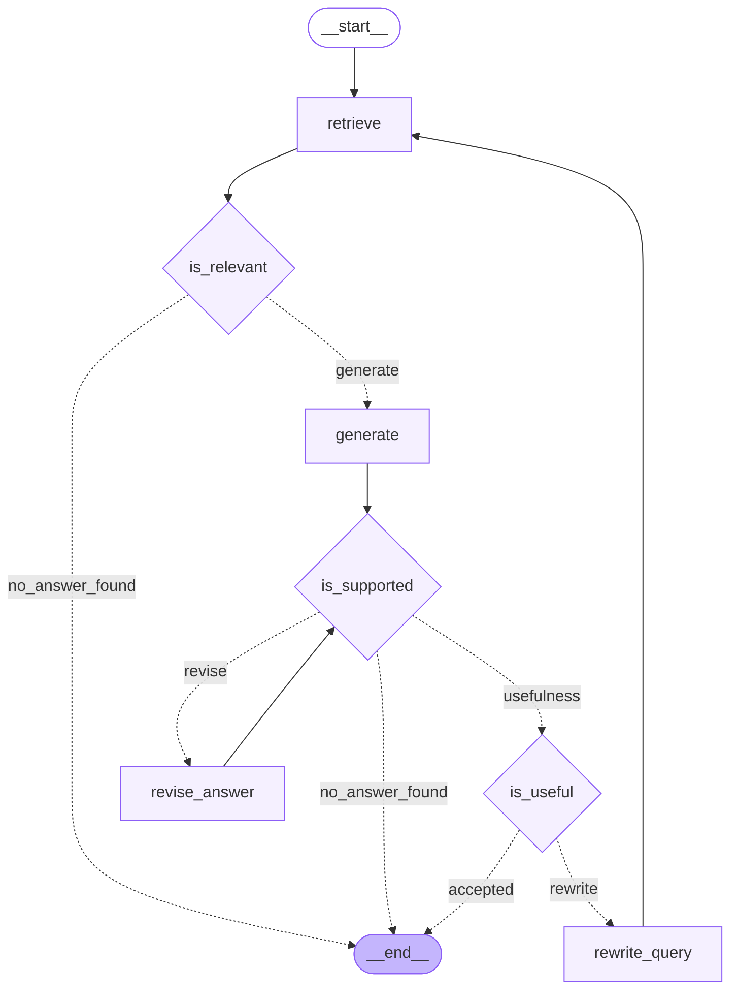

# Agentic RAG

A configurable, stateful RAG workflow built with LangGraph for retrieval, answer validation, and iterative refinement.

## Workflow



## Installation

```bash
pip install agentic-rag
```

## Usage

```python
from agentic_rag import AgenticRAGConfig, build_graph
```

Create a compatible LangChain chat model and provide a retrieval callable, then build the workflow:

```python
config = AgenticRAGConfig(max_attempts=2)

graph = build_graph(
    llm=llm,
    rag_search=rag_search,
    config=config,
)
```

Invoke the compiled graph with the initial state required by the workflow.

## License

This project is licensed under the MIT License. See [LICENSE](LICENSE) for details.